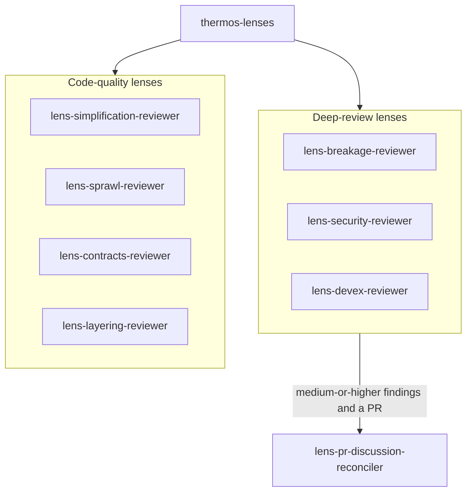

# Thermos Experimental plugin

Experimental variants of the [Thermos plugin](../thermos/README.md), each built to be measured against `/thermos`. Each entry point changes one thing about the shipped review, so a comparison shows what that one change does.

> **This plugin is built from the Claude Code port of the official Cursor Thermos plugin** (<https://github.com/cursor/plugins/tree/main/thermos>). The review rubrics and agent design are Cursor's original work. See [LICENSE](LICENSE) for the combined MIT notice covering both Cursor (original) and the porter.

The plugin stays at version `0.x.y`. It never reaches 1.0: an experiment that proves itself is ported into `thermos` instead. Any release can rename or remove an entry point.

## Installation

```bash
/plugin marketplace add LayZeeDK/thermos-claude-plugin
/plugin install thermos-experimental@thermos-claude-plugin
```

It installs next to `thermos` and does not need it.

## Entry points

| Entry point | Compared with `/thermos`, it changes |
|:------------|:-------------------------------------|
| `/thermos-experimental:thermos-lenses` | The topology. Seven narrow lens reviewers and a PR-discussion reconciler replace the two broad reviewers. The rubric text is upstream's, split across the lenses in upstream order. The lens files only cut fragments, change names, and drop or renumber steps; they add no wording of their own. |

Whether the lens split finds more confirmed issues per token than `/thermos` is not measured yet.

## `thermos-lenses`



The orchestrator launches the seven lenses in parallel. If there is a PR for the branch and a deep-review lens reports medium-or-higher findings, it then launches the reconciler with those findings. The reconciler reads the BugBot and human PR/MR threads, validates and dedupes them against the findings, and attributes what it adds. The lenses never see the PR discussion.

| Agent | Rubric skills it preloads | Reviews |
|:------|:--------------------------|:--------|
| `lens-breakage-reviewer` | `lens-review-shared`, `lens-breakage-review` | Bugs and changes that break existing functionality. |
| `lens-security-reviewer` | `lens-review-shared`, `lens-security-review` | Security vulnerabilities and feature-gate leaks. |
| `lens-devex-reviewer` | `lens-review-shared`, `lens-devex-review` | Changes that break developers' ability to run or build the code locally. |
| `lens-pr-discussion-reconciler` | `lens-review-shared`, `lens-pr-discussion-review` | BugBot and human PR/MR threads, checked against the deep-review findings. |
| `lens-simplification-reviewer` | `lens-code-quality-shared`, `lens-simplification-review` | Structural regressions and missed code-judo simplifications (rules 0 and 3). |
| `lens-sprawl-reviewer` | `lens-code-quality-shared`, `lens-sprawl-review` | File-size growth past 1k lines and spaghetti branching (rules 1 and 2). |
| `lens-contracts-reviewer` | `lens-code-quality-shared`, `lens-contracts-review` | Magic abstractions, thin wrappers, and type and boundary contracts (rules 4 and 5). |
| `lens-layering-reviewer` | `lens-code-quality-shared`, `lens-layering-review` | Logic in the wrong layer, duplicated helpers, and sequential or non-atomic orchestration (rules 6 and 7). |

The two `-shared` skills carry the rubric text every lens of a family needs: scope, intended breakage, over-reporting, and the critical rules for the deep review; the core prompt, the code-judo push, review tone, output order, and approval bar for code quality. The rubric skills are hidden from the `/` menu (`user-invocable: false`). Their one-line descriptions still appear in the skill listing of every session that has the plugin installed.

### Usage

Run `/thermos-experimental:thermos-lenses` with the same arguments as `/thermos`: a branch, PR, commit, or range, then any of `--effort <level>` and `--model <model>`.

- `--effort <level>`, for example `--effort xhigh`, runs every lens and the reconciler at that effort level through the Agent tool's per-call `effort` parameter. It needs Claude Code v2.1.292 or later. The orchestrator runs at the session's effort.
- `--model <model>`, for example `--model sonnet`, runs every lens and the reconciler on that model through the Agent tool's per-call `model` parameter. The orchestrator and its synthesis stay on the session model. Use `opus` or `sonnet`. Fable 5.1 works but is unmeasured, so `fable` is accepted without any statement about its cost or quality.

A review runs seven reviewer agents, plus the reconciler when it is needed, where `/thermos` runs two. Each lens reads the same diff. What that costs relative to `/thermos` is not measured yet.

## Maintenance

Every skill and agent in this plugin is generated from the upstream-identical files in `plugins/thermos` by `tools/thermos-experimental-generator/`. Change `slice-map.ts` there and run `npm run generate`; do not edit the generated files. `npm test` fails when a generated file differs from the generator's output, and the generator fails when an upstream rubric line lands in no lens. After `/sync-from-cursor` updates the upstream rubrics, run `npm run generate`.

## License

MIT. This plugin preserves Cursor's original copyright and adds the porter's; see [LICENSE](LICENSE).
