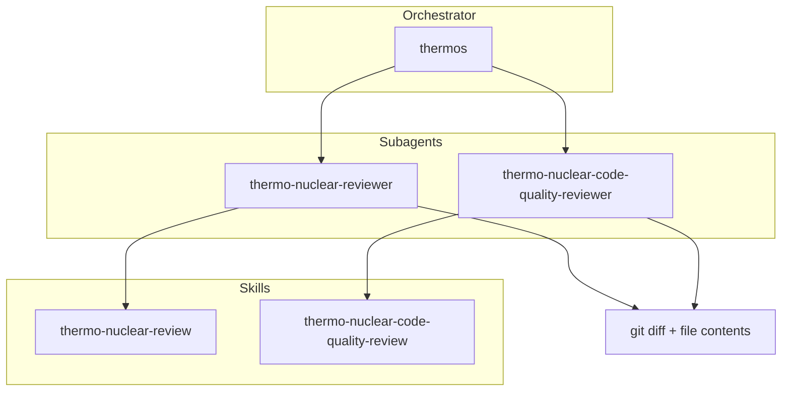

# Thermos plugin (Claude Code port)

Thermo-nuclear branch review for Claude Code agents: deep correctness and security audits, harsh maintainability rubrics, and parallel subagent orchestration.

> **This is a Claude Code port of the official Cursor Thermos plugin** (<https://github.com/cursor/plugins/tree/main/thermos>). The review rubrics, agent design, and architecture are Cursor's original work; this repository adapts them to Claude Code's plugin format, skill/agent frontmatter, and orchestration primitives. It is a port, not original art. See [LICENSE](LICENSE) for the combined MIT notice covering both Cursor (original) and the porter.

## Installation

```bash
/plugin marketplace add LayZeeDK/thermos-claude-plugin
/plugin install thermos@thermos-claude-plugin
```

## Architecture



## Skills

| Skill | Description |
|:------|:------------|
| `thermo-nuclear-review` | Deep branch audit (bugs, breakages, security, devex, feature-gate leaks). |
| `thermo-nuclear-code-quality-review` | Strict maintainability audit (code-judo, 1k-line rule, spaghetti, boundaries). |
| `thermos` | Run both review subagents in parallel and synthesize findings. |

## Agents

| Agent | Description |
|:------|:------------|
| `thermo-nuclear-reviewer` | Agent subagent for deep review rubric (diff-scoped). |
| `thermo-nuclear-code-quality-reviewer` | Agent subagent for code-quality rubric (diff-scoped). |

## Typical usage

**Double review (thermos):**

1. Gather `git diff main...HEAD` and full contents of changed files.
2. Invoke both subagents in one message with `run_in_background: true`.
3. Synthesize prioritized, deduped findings.

Add `--effort <level>` to `/thermos`, for example `/thermos --effort xhigh`, to run both reviewers at that effort level. Claude passes it as the Agent tool's per-call `effort` parameter, which needs Claude Code v2.1.292 or later.

Add `--model <model>`, for example `/thermos --model sonnet`, to run both reviewers on that model. Claude passes it as the Agent tool's per-call `model` parameter. You can combine both, as in `/thermos --effort high --model opus`.

**Single skill:** invoke `thermo-nuclear-review` or `thermo-nuclear-code-quality-review` in the main agent, or the matching subagent after gathering diff context.

## License

MIT. This port preserves Cursor's original copyright and adds the porter's; see [LICENSE](LICENSE).
